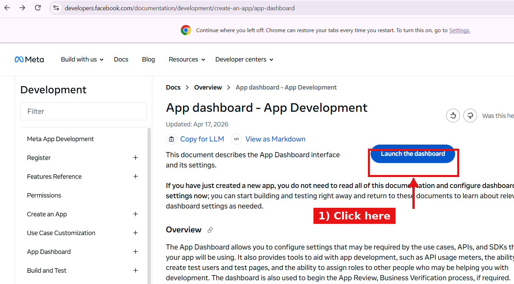

# از صفر تا اولین پست — ویندوز

این فایل را قدم‌به‌قدم انجام بده. هر قدم را که تمام کردی، برو قدم بعد. هیچ‌جا را رد نکن.

---

## قدم ۱ — پیجت را آماده کن (۵ دقیقه)

در اپ اینستاگرام:

1. پروفایل → منوی سه‌خط → **Settings and activity**
2. **Account type and tools** → **Switch to professional account**
3. یکی از دو گزینه را بزن: **Business** یا **Creator** (هر کدام، فرقی ندارد)
4. مطمئن شو پیج **Public** است: Settings → **Account privacy** → خاموش

اگر پیجت Private باشد، اینستاگرام توکن نمی‌دهد.

---

## قدم ۲ — Node.js را نصب کن (۳ دقیقه)

1. برو به [nodejs.org](https://nodejs.org)
2. دکمهٔ سبز **LTS** را بزن و نصب کن (Next, Next, Finish)
3. برای اطمینان: `Win + R` → بنویس `cmd` → Enter → بنویس:
   ```
   node -v
   ```
   باید چیزی مثل `v22.11.0` نشان بدهد. ✅

---

## قدم ۳ — کد را روی کامپیوتر بیاور (۲ دقیقه)

ساده‌ترین راه:

1. این لینک را در مرورگر باز کن:
   `https://github.com/mylifezr7/azmayeshi/archive/refs/heads/arena/a5ec1bf0-azmayeshi.zip`
2. فایل ZIP دانلود می‌شود. **Extract All** کن.
3. پوشهٔ `azmayeshi-arena-a5ec1bf0-azmayeshi` را ببر داخل `C:\` تا مسیرش ساده شود.
4. داخل آن، پوشهٔ `instagram-uploader` را ببین. کل کار ما داخل همین پوشه است.

---

## قدم ۴ — گرفتن توکن (۱۰ دقیقه، فقط یک بار)

«توکن» یعنی یک کلید بلند که به ربات می‌گوید «از طرف من پست بگذار». آن را از سایت متا می‌گیریم.

**۴.۱ — ورود به سایت متا**

❗ صفحه‌ای که الان باز کرده‌ای صفحهٔ **مستندات** است، نه داشبورد. آن دکمهٔ آبی را بزن:



1. روی دکمهٔ آبی **Launch the dashboard** (بالا سمت راست صفحه) کلیک کن.
2. اگر گفت باید وارد شوی: با اکانت فیسبوک خودت وارد شو. (اگر فیسبوک نداری، همان اکانت اینستاگرامت را با ایمیل وارد کن.)
   اگر پیام **Register as a Developer** / **Complete registration** آمد: شماره موبایل و ایمیل بده و Continue — یک بار است.
3. حالا در **App Dashboard** هستی: صفحه‌ای با دکمهٔ **Create App** (بالا سمت راست). اگر از قبل اپی داری، لیست اپ‌ها را می‌بینی.

**۴.۲ — ساخت اپ**
4. دکمهٔ **Create App** (بالا سمت راست).
5. صفحهٔ اول «use case» است: گزینهٔ **Manage messaging & content on Instagram** را انتخاب کن → Next.
   اگر این گزینه نبود، **Other** → Next → **Business** را انتخاب کن.
6. در صفحهٔ بعد App type: **Business** را بزن → Next.
7. اسم اپ: هر چیزی، مثلاً `myreels` (کلمهٔ Instagram یا Facebook در اسم نگذار). ایمیلت را هم بزن → **Create app** → شاید رمز فیسبوک را دوباره بخواهد، بزن.

**۴.۳ — اتصال پیج و گرفتن توکن**
8. حالا داخل داشبورد اپی. از منوی سمت چپ: **Instagram** → **API setup with Instagram login**
   ⚠️ اگر گزینهٔ «API setup with Instagram login» نبود، اول باید محصول Instagram را اضافه کنی: در همان صفحهٔ اول داشبورد، پایین دنبال **Add product / Instagram** بگرد و **Set up** را بزن.
   ⚠️ گزینهٔ اشتباه: «API Setup with **Facebook** Login» — آن مسیر جداگانه‌ای است و به صفحهٔ فیسبوک نیاز دارد.
9. در صفحهٔ باز شده، بخش شمارهٔ **1. Generate access tokens** را پیدا کن.
10. دکمهٔ **Add account** را بزن → یک پنجرهٔ کوچک باز می‌شود → با اکانت اینستاگرامت وارد شو → **Allow / Authorize**.
    - پنجره باز نشد؟ پاپ‌آپ مرورگر را اجازه بده.
    - پیجت اضافه نشد؟ پیج باید **Public** باشد و حرفهای (قدم ۱). برو یک بار دیگر امتحان کن.
11. حالا اسم پیجت در لیست است، کنارش دکمهٔ **Generate token** را بزن → دوباره Allow → یک رشتهٔ خیلی بلند ظاهر می‌شود که با **IGQ** شروع می‌شود.

**👇 همین رشته را کپی کن. کار شناسهٔ اکانت را خودِ ربات انجام می‌دهد؛ لازم نیست دنبال عدد بگردی.**

> توکن ۶۰ روز کار می‌کند. هر ماه `node cli.js refresh-token --save` را بزن تا ۶۰ روز دیگر تمدید شود.
> توکن را در چت، عکس یا گیت‌هاب نگذار. فقط روی کامپیوتر خودت.

## قدم ۵ — آدرس عمومی بساز (۵ دقیقه)

اینستاگرام ویدیو را از اینترنت می‌گیرد، پس به یک آدرس عمومی نیاز است.

1. `cmd` را باز کن (Win + R → `cmd`)
2. این را بزن:
   ```
   winget install --id Cloudflare.cloudflared
   ```
   اگر پرسید Y/N، `Y` بزن. بعد از نصب، `cmd` را ببند و دوباره باز کن.
3. حالا این را بزن و **باز بگذار** (این پنجره نباید بسته شود):
   ```
   cloudflared tunnel --url http://localhost:8787
   ```
4. یک آدرس مثل `https://random-words-here.trycloudflare.com` چاپ می‌شود. کپی‌اش کن.

---

## قدم ۶ — تنظیم یک‌باره (۲ دقیقه)

1. برو داخل پوشهٔ `instagram-uploader`
2. روی **`setup.bat`** دوبار کلیک کن
3. فقط دو چیز می‌پرسد:
   - **توکن** → همان رشتهٔ `IGQ...` را بچسبان (کلیک راست = Paste) و Enter
   - **آدرس عمومی** → همان آدرس `trycloudflare.com` از قدم ۵ (اگر هنوز نداری Enter بزن)
4. ربات خودش اکانت را پیدا می‌کند و آخرش تست می‌گیرد.
   باید ببینی: `✅ پیدا شد: @اسم_پیجت` و در تست فایل `HTTP 200`.

اگر این دو خط را دیدی، همه‌چیز آماده است. برو قدم ۷.

## قدم ۷ — ویدیو بگذار و پست کن

1. ویدیویت را کپی کن داخل پوشهٔ `instagram-uploader\media\`
   - MP4، عمودی (۹:۱۶)، بین ۳ ثانیه تا ۱۵ دقیقه
2. کپشن: کنار ویدیو یک فایل متنی هم‌نام بساز. مثلاً ویدیو `clip1.mp4` → فایل `clip1.txt` با متن فارسی‌ات.
3. روی `post.bat` دوبار کلیک کن. تمام. ✅

بعد از این، هر ویدیوی جدیدی که در `media` بگذاری، با دوبار کلیک روی `post.bat` منتشر می‌شود و تکراری پست نمی‌شود.

---

## اگر خطا دیدی

| پیام | یعنی چه | چه کن |
| --- | --- | --- |
| `Node.js نصب نیست` | Node را نصب نکردی | قدم ۲ |
| `این توکن از API Setup قدیمی است` | توکن `IGAA...` گرفتی (مسیر مرده) | قدم ۴.۳ را دوباره انجام بده و از «API setup with Instagram login» توکن بگیر |
| `با این توکن اکانتی پیدا نشد` | توکن کوتاه‌مدت یا اشتباه است / پیج Private است | دوباره Generate token بزن؛ پیج Public باشد |
| `Invalid OAuth access token` | توکن اشتباه/منقضی | توکن تازه بگیر (قدم ۴) |
| `فایل از بیرون قابل خواندن نیست` | تونل بسته است یا آدرس غلط | قدم ۵ را دوباره اجرا کن و آدرس تازه را در setup.bat بگذار |
| `پورت 8787 اشغال است` | یک بار دیگر ربات باز است | پنجره‌های قبلی `cmd` را ببند |
| `اکانت BUSINESS/CREATOR نیست` | پیجت حرفه‌ای نیست | قدم ۱ |
| `Media download has failed` | اینستاگرام به فایل نرسید | تونل باز است؟ آدرس درست است؟ فایل از ۳۰۰ مگابایت کمتر است؟ |

اگر هیچ‌کدام جواب نداد، متن کامل خطا (بدون توکن) را بفرست.
